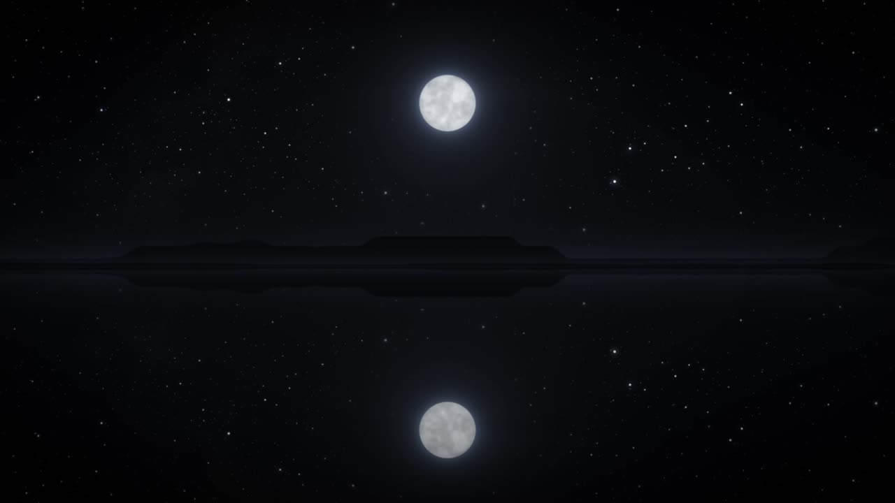
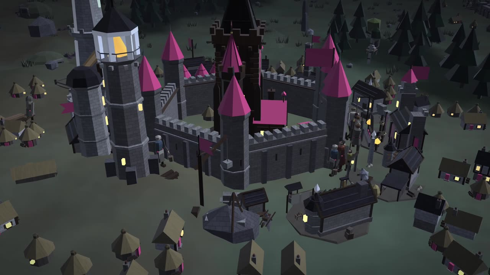

<h1 align="center">Hi, I'm Ael</h1>

I'm building Nullmere Online, a strategy MMO for macOS.

  

## Nullmere Online

One persistent world around a still black lake, shared by every player: a native
Swift and Metal client, a SpacetimeDB realm, on-device AI, and original 3D models,
music and sound.

  

[Repository](https://github.com/ael-dev3/Nullmere) · [Trailer](https://github.com/ael-dev3/Nullmere/releases/tag/trailer)

## Earlier work

- **[Warpkeep](https://github.com/ael-dev3/Warpkeep)**: Nullmere's predecessor, now halted.
- **[Ashen Hallow](https://github.com/ael-dev3/Ashen-Hallow)**: a fantasy autobattler playable in the browser. [Play](https://ael-dev3.github.io/Ashen-Hallow/).
- **[Allthing](https://github.com/ael-dev3/Allthing)**: an independent Farcaster client on Snapchain and Hypersnap, built with Rust and Leptos on Cloudflare Workers.
- **[Degen Dogs](https://github.com/ael-dev3/Degen-Dogs-Mission-3)**: community auction analytics on Base, with searchable history and downloadable data. [Dashboard](https://ael-dev3.github.io/Degen-Dogs-Mission-3/).

All four are archived. More in [Projects](PROJECTS.md).

[Farcaster](https://farcaster.xyz/0xael.eth) · [X](https://x.com/0xAell)
